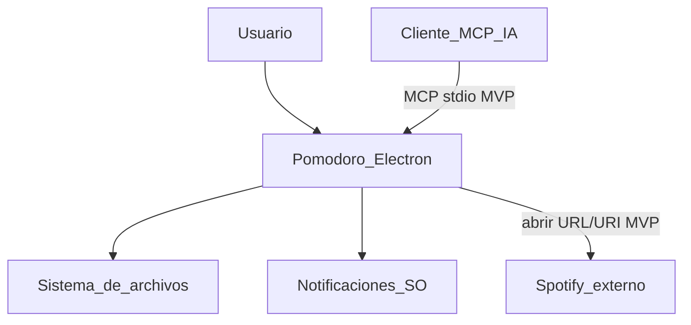
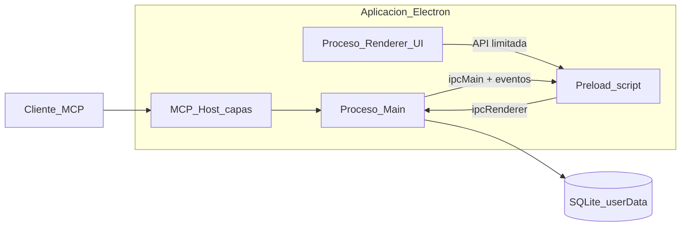
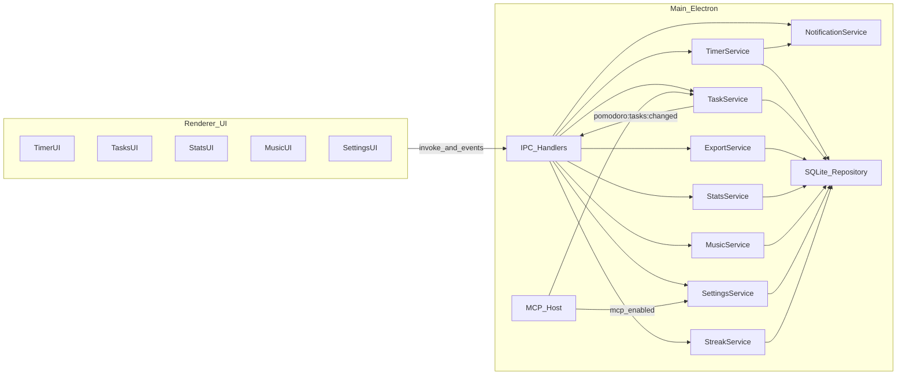
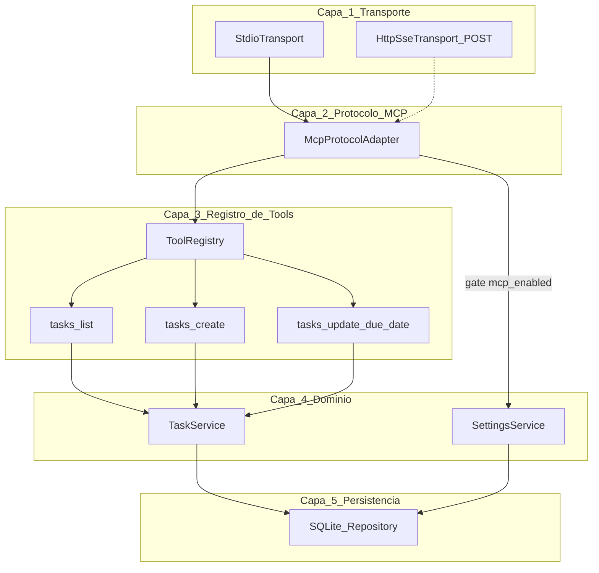
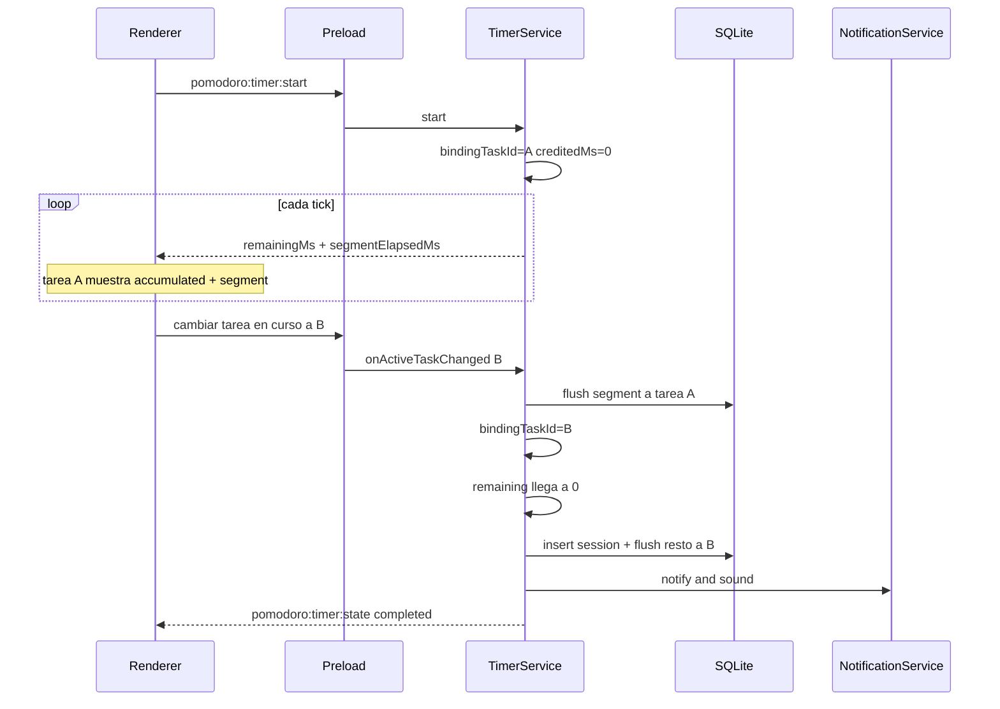

# Diseño de arquitectura — Aplicación Pomodoro

**Producto:** aplicación de escritorio con **Electron**.  
**Datos:** SQLite local en el directorio `userData` (sin backend ni cuentas en el MVP).  
**Referencias:** [01 requerimientos.md](01%20requerimientos.md), [02 historias-usuario.md](02%20historias-usuario.md), [04 diseño-base-datos.md](04%20diseño-base-datos.md).

## 1. Objetivos de arquitectura

- Separar UI (renderer) de lógica de temporizador, persistencia y sistema (main).
- Garantizar un temporizador fiable con la ventana minimizada o en segundo plano.
- Aplicar modelo de seguridad recomendado de Electron.
- Permitir exportación de archivos y notificaciones nativas del SO.
- Exponer un **servidor MCP por capas** para asistentes de IA, reutilizando los mismos servicios de dominio que la UI.
- Dejar espacio para integración Spotify vía API en fases POST sin reescribir el núcleo.

## 2. Vista de contexto




Spotify se usa abriendo el cliente/web externo. El MCP comparte el almacén local con la UI; no hay backend en la nube.

## 3. Vista de contenedores (procesos Electron)




| Proceso / componente | Responsabilidad                                                                                         |
| -------------------- | ------------------------------------------------------------------------------------------------------- |
| **Main**             | Ciclo de vida, temporizador, SQLite, export, notificaciones, IPC, arranque/parada del MCP Host          |
| **MCP Host**         | Servidor MCP en capas; se ejecuta en Main o como entrypoint hermano que importa los mismos servicios/BD |
| **Preload**          | Expone `window.pomodoroAPI`; sin Node completo en la página                                             |
| **Renderer**         | UI (Timer, Tareas, Estadísticas, Música, Configuración); escucha `pomodoro:tasks:changed` tras mutaciones MCP |


### 3.1 Seguridad (obligatorio)


| Ajuste             | Valor                                                                     |
| ------------------ | ------------------------------------------------------------------------- |
| `contextIsolation` | `true`                                                                    |
| `nodeIntegration`  | `false`                                                                   |
| `sandbox`          | `true` cuando sea viable con el preload                                   |
| CSP                | Restringir scripts locales; sin eval innecesario                          |
| MCP MVP            | Solo transporte **stdio** local; flag `mcp_enabled`; sin bind a `0.0.0.0` |


El renderer **no** accede a `fs`, SQLite ni `Notification` de Node directamente; todo pasa por IPC.

## 4. Vista de componentes




### 4.1 Módulos main


| Módulo                | Función                                                                           |
| --------------------- | --------------------------------------------------------------------------------- |
| `TimerService`        | Estado del periodo; tick con `endsAt`; persistencia + notificaciones al completar |
| `TaskService`         | CRUD, filtros, due dates, tarea activa; **única puerta de reglas** para UI y MCP  |
| `ExportService`       | CSV/JSON + diálogo nativo                                                         |
| `StatsService`        | Agregaciones día/semana/mes                                                       |
| `StreakService`       | Racha diaria (HU-19)                                                              |
| `MusicService`        | Playlists locales + `openExternal`                                                |
| `SettingsService`     | Ajustes, incl. `mcp_enabled`                                                      |
| `NotificationService` | Notificaciones + sonido                                                           |
| `SQLite_Repository`   | BD y migraciones                                                                  |
| `MCP Host`            | Capas de transporte, protocolo y registro de tools (sección 5)                    |


### 4.2 Módulos renderer

- **TimerUI:** control del temporizador y estado del periodo.
- **TasksUI:** listado, filtros y CRUD de tareas.
- **StatsUI:** agregaciones día/semana/mes.
- **MusicUI:** listas locales y apertura externa.
- **SettingsUI:** ajustes, interruptor MCP y texto de configuración para el cliente de IA.

## 5. Servidor MCP por capas

Objetivo: añadir una tool nueva = registrar handler + schema, sin tocar transporte ni SQLite.




| Capa                     | Responsabilidad                                            | Qué NO hace                    |
| ------------------------ | ---------------------------------------------------------- | ------------------------------ |
| **1. Transporte**        | stdio (MVP); futuro HTTP/SSE                               | No conoce tools ni SQL         |
| **2. Protocolo MCP**     | capabilities, `tools/list`, `tools/call`, errores JSON-RPC | No implementa reglas de tareas |
| **3. Registro de tools** | nombre, descripción, JSON Schema de input, `execute(args)` | No abre la BD                  |
| **4. Dominio**           | `TaskService` (validaciones, RN); `SettingsService` solo para el gate `mcp_enabled` | No habla MCP |
| **5. Persistencia**      | SQL / migraciones                                          | No conoce MCP ni UI            |


### 5.1 Cómo agregar una tool nueva

1. Crear archivo en `mcp/tools/` (p. ej. `tasks-create.js`) con `name`, `description`, `inputSchema`, `handler`.
2. Registrar en `ToolRegistry.register(...)`.
3. Delegar al método existente o nuevo de `TaskService`.
4. No modificar `StdioTransport` ni `SQLite_Repository`.

### 5.2 Tools MVP


| Name                    | Dominio                                  |
| ----------------------- | ---------------------------------------- |
| `tasks_list`            | `TaskService.list(filters)`              |
| `tasks_create`          | `TaskService.create(input)`              |
| `tasks_update_due_date` | `TaskService.updateDueDate(id, dueDate)` |


Tras mutación: `TaskService` emite evento interno → IPC `pomodoro:tasks:changed` → UI.

### 5.3 Modos de ejecución del MCP Host


| Modo                                | Uso                                                                                                           |
| ----------------------------------- | ------------------------------------------------------------------------------------------------------------- |
| **Empaquetado con Electron**        | Main inicia el host cuando `mcp_enabled` y la app está abierta                                                |
| **Entrypoint CLI** (`pomodoro-mcp`) | Cliente (Claude Desktop / Cursor) lanza el proceso por stdio apuntando a la misma `pomodoro.db` en `userData` |


Ambos modos importan las mismas capas 3–5. El CLI es el patrón habitual para Claude/Cursor; ChatGPT u otros clientes usarán el transporte que soporten (HTTP/SSE en POST sobre la misma capa 2–5).

### 5.4 Estructura de carpetas MCP

```text
Pomodoro/
  .
  .
  .
  mcp/
    transport/
      stdio.js
      http-sse.js          # POST / stub
    protocol/
      mcp-adapter.js
    registry/
      tool-registry.js
    tools/
      tasks-list.js
      tasks-create.js
      tasks-update-due-date.js
    index.js          

```

## 6. Temporizador: flujo fiable

El temporizador **no** debe depender solo de `setInterval` en el renderer (throttling en segundo plano).

**Enfoque elegido:** en `TimerService` (main) se guarda `endsAt` (epoch ms). Un intervalo en main (~250–1000 ms) calcula `remaining = endsAt - now` y publica actualizaciones. Al pausar se guarda `remainingMs` y se limpia `endsAt`. Al reanudar se recalcula `endsAt`.

### 6.1 Tiempo acumulado de la tarea en curso

En periodos `focus` con tarea vinculada, el tick no solo reduce el cronómetro: también alimenta el **tiempo acumulado visible** de esa tarea. La atribución es por **tramos** (`bindingTaskId`): si el usuario cambia la tarea en curso a mitad del periodo, el tiempo ya transcurrido se acredita a la tarea anterior y el nuevo tramo empieza a sumar en la nueva.

| Momento | Comportamiento |
| ------- | -------------- |
| **Start** | Se fija `bindingTaskId` = tarea activa; `creditedMs = 0`. |
| **Tick (running)** | `remainingMs` baja; `segmentElapsedMs = elapsedMs - creditedMs` sube. La UI muestra `accumulated_ms` + `segmentElapsedMs` solo en `bindingTaskId`. |
| **Cambio de tarea en curso** | Se hace flush: `accumulated_ms += segmentElapsedMs` en la tarea anterior; `creditedMs = elapsedMs`; `bindingTaskId` pasa a la nueva. |
| **Pausa** | Se conserva el tramo en la vista; el acumulado mostrado no retrocede. |
| **Completar periodo** | Se persiste el tramo restante (`durationMs - creditedMs`) en la tarea actual + `completed_pomodoros += 1` + sesión. |
| **Reset / stop / cambio de modo forzado** | Se descarta el tramo no acreditado; lo ya flusheado a tareas anteriores permanece. |

Así el usuario ve el acumulado **crecer en vivo** mientras el cronómetro decrece, sin “llevarse” el tiempo de la tarea anterior al cambiar de tarea en curso.




## 7. IPC (contrato de alto nivel)

Canales orientativos (`invoke` / eventos). Prefijo `pomodoro:`.


| Canal | Dirección | Uso |
| ----- | --------- | --- |
| `pomodoro:timer:start` | Renderer → Main (`invoke`) | Iniciar periodo |
| `pomodoro:timer:pause` | Renderer → Main (`invoke`) | Pausar periodo |
| `pomodoro:timer:resume` | Renderer → Main (`invoke`) | Reanudar periodo |
| `pomodoro:timer:state` | Main → Renderer (event) | Snapshots de progreso y finalización |
| `pomodoro:tasks:list` | Renderer → Main (`invoke`) | Listar / filtrar tareas |
| `pomodoro:tasks:create` | Renderer → Main (`invoke`) | Crear tarea |
| `pomodoro:tasks:update` | Renderer → Main (`invoke`) | Actualizar tarea |
| `pomodoro:tasks:export` | Renderer → Main (`invoke`) | Export CSV/JSON con filtros |
| `pomodoro:tasks:changed` | Main → Renderer (event) | Refresco tras UI o MCP |
| `pomodoro:stats:get` | Renderer → Main (`invoke`) | Rangos y totales |
| `pomodoro:streak:get` | Renderer → Main (`invoke`) | Valor de racha |
| `pomodoro:music:list` | Renderer → Main (`invoke`) | Listar playlists |
| `pomodoro:music:add` | Renderer → Main (`invoke`) | Añadir playlist |
| `pomodoro:music:select` | Renderer → Main (`invoke`) | Seleccionar playlist activa |
| `pomodoro:settings:get` | Renderer → Main (`invoke`) | Leer ajustes |
| `pomodoro:settings:set` | Renderer → Main (`invoke`) | Guardar ajustes |


Errores: respuestas `{ ok: false, error: code }` sin filtrar excepciones crudas al renderer.

## 8. Persistencia y ubicación


| Recurso             | Ubicación                               |
| ------------------- | --------------------------------------- |
| Base SQLite         | `{app.getPath('userData')}/pomodoro.db` |
| Sonidos / assets    | empaquetados con la app                 |
| Archivos exportados | ruta elegida por el usuario             |
| Entrypoint MCP CLI  | binario/script que abre la misma BD     |


Detalle de esquema: [04 diseño-base-datos.md](04%20diseño-base-datos.md).

## 9. Integración Spotify (MVP vs POST)


| Fase     | Diseño                                                                                                                                     |
| -------- | ------------------------------------------------------------------------------------------------------------------------------------------ |
| **MVP**  | `MusicService` guarda URL/URI; `open` usa `shell.openExternal`. Sin secretos OAuth.                                                        |
| **POST** | Nuevo `SpotifyAuthService` + API Web Playback/Control; tokens cifrados en `userData`; mismos IPC de “lista activa”, controles adicionales. |


YouTube Music queda como conector simétrico POST.

## 10. Empaquetado y estructura de repo sugerida

```text
Pomodoro/
  electron-main/
    main.js
    preload.js
    ipc/
    services/
    db/
  ui/
    assets/
    components/
    router/
    stores/
    views/
    App.vue
    main.js
  mcp/  
  documentos/
  index.html
  package.json
```

Empaquetado posterior con electron-builder o similar.

## 11. Decisiones y trade-offs


| Decisión                          | Motivo                                                |
| --------------------------------- | ----------------------------------------------------- |
| Temporizador en main              | Evitar throttling del renderer                        |
| SQLite en main                    | Historial/export robustos; un escritor                |
| MCP por capas + ToolRegistry      | Extender tools sin tocar transporte ni SQL            |
| Mismo `TaskService` para UI y MCP | Una sola fuente de reglas de negocio                  |
| stdio en MVP                      | Compatible con Claude Desktop / Cursor; sin abrir red |
| HTTP/SSE POST                     | Capa 1 intercambiable para clientes que no usen stdio |
| Spotify solo enlace en MVP        | Valor musical sin OAuth                               |


## 12. Riesgos


| Riesgo                          | Mitigación                                                                    |
| ------------------------------- | ----------------------------------------------------------------------------- |
| Suspensión del SO pausa timers  | Recalcular con `endsAt` al despertar                                          |
| Corrupción de BD                | Migraciones versionadas; backup POST                                          |
| Permisos de notificación        | Fallback a sonido + UI                                                        |
| Condiciones de carrera UI ↔ MCP | Un solo writer SQLite; transacciones; evento `pomodoro:tasks:changed`         |
| Cliente MCP mal configurado     | Documentar snippet; `mcp_enabled` off por defecto; aviso al activarlo         |


