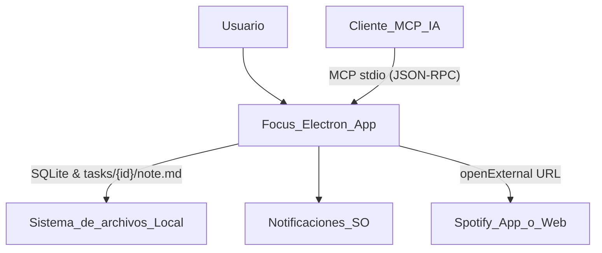
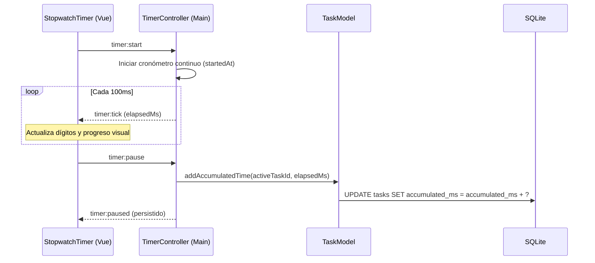

# Diseño de arquitectura — Aplicación Focus (Cronómetro y Priorización Vectorial)

**Producto:** aplicación de escritorio con **Electron** y **Vue 3** (Vite).  
**Datos:** SQLite local en el directorio `userData` (sin backend ni servicios en la nube obligatorios).  
**Estilo:** Apple Human Interface Guidelines (macOS / iOS dark mode, glassmorphism y tipografía SF).  
**Referencias:** [01 requerimientos.md](01%20requerimientos.md), [02 historias-usuario.md](02%20historias-usuario.md), [04 diseño-base-datos.md](04%20diseño-base-datos.md).

---

## 1. Objetivos de arquitectura

- **Motor de Cronómetro fiable en proceso Main:** El cronómetro de enfoque corre en el proceso principal de Electron, garantizando que el cómputo del tiempo transcurrido no sufra ralentizaciones (*throttling*) causadas por el ciclo de renderizado o ventanas minimizadas.
- **Priorización Vectorial en Dominio:** Lógica de cálculo matemático del vector $\vec{t} = [I, U, E, D, R]$ centralizada en `TaskModel`, asegurando consistencia idéntica en UI, exportaciones y servidor MCP.
- **Acreditación continua a tareas:** Conexión en tiempo real entre el cronómetro y el campo `accumulated_ms` de la tarea activa.
- **Diseño Apple Human Interface Guidelines:** Sistema de diseño modular en CSS vanilla (`ui/style.css`) con variables de color nativas de Apple, translucidez `backdrop-filter`, controles segmentados e iconografía moderna.
- **Servidor MCP por capas:** Exposición desacoplada de herramientas para clientes de IA (Claude, Cursor, etc.), compartiendo el mismo almacén SQLite y modelos de dominio.

---

## 2. Vista de contexto



---

## 3. Vista de contenedores (procesos Electron)

```mermaid
flowchart LR
  subgraph electronApp [Aplicación Electron]
    Main[Proceso Main]
    Preload[Preload Script seguro]
    Renderer[Proceso Renderer (Vue 3 + Vite)]
    McpHost[MCP Host por capas]
  end
  DB[(SQLite userData/pomodoro.db)]
  Notes[(tasks/id/note.md + assets/)]
  AI[Cliente MCP]

  Main --> DB
  Main --> Notes
  McpHost --> Main
  AI --> McpHost
  Renderer -->|"window.api"| Preload
  Preload -->|"ipcRenderer"| Main
  Main -->|"ipcMain + eventos"| Preload
```

### 3.1 Seguridad y aislamiento

| Directiva | Valor | Justificación |
| --------- | ----- | ------------- |
| `contextIsolation` | `true` | Evita que el Renderer acceda a los prototipos y APIs nativas de Node.js. |
| `nodeIntegration` | `false` | Impide ejecución arbitraria de Node en el DOM. |
| `sandbox` | `false` | Requerido por el preload actual para IPC estructurado de alto rendimiento. |
| `protocol` | `mdmedia://` | Manejador de esquema personalizado para servir imágenes locales de notas sin exponer rutas del sistema de archivos al DOM abierto. |

---

## 4. Vista de componentes

```mermaid
flowchart TB
  subgraph renderer [Renderer (Vue 3 + Pinia)]
    direction TB
    AppHeader[AppHeader (macOS Traffic Lights)]
    TimerStage[TimerStage (Apple Stopwatch Stage)]
    StopwatchTimer[StopwatchTimer (Circular Apple UI)]
    TaskItem[TaskOpenItem (Priority Badge + Popover)]
    TaskModal[TaskFormModal (Apple Sheet + Vector Sliders)]
    TaskPriorityMenu[TaskPriorityMenu (Apple Popover Segmented)]
    TaskNotes[TaskEditMarkDownPanel (Markdown + Assets)]
  end

  subgraph mainProc [Main Process (Electron)]
    direction TB
    TimerCtrl[TimerController (Stopwatch Engine)]
    TaskCtrl[TaskController]
    TaskMdl[TaskModel (Vector Math)]
    NoteMdl[NoteModel (Markdown Storage)]
    ExportCtrl[ExportController]
    SettingsCtrl[SettingsController]
    DbRepo[SQLite Database & Migrations]
    McpServer[MCP Protocol & Tool Registry]
  end

  renderer -->|"IPC invoke / on"| TimerCtrl
  renderer -->|"IPC invoke / on"| TaskCtrl
  renderer -->|"IPC invoke / on"| ExportCtrl
  renderer -->|"IPC invoke / on"| SettingsCtrl
  
  TimerCtrl --> TaskMdl
  TaskCtrl --> TaskMdl
  TaskCtrl --> NoteMdl
  ExportCtrl --> TaskMdl
  McpServer --> TaskCtrl
  TaskMdl --> DbRepo
  SettingsCtrl --> DbRepo
```

---

## 5. Motor de Cronómetro (Stopwatch Engine)

A diferencia de un temporizador de cuenta regresiva cíclico, el **cronómetro de enfoque** opera de manera ascendente continua:

1. **Alta resolución con timestamp de época:**
   - Al iniciar (`start`), se registra `startedAt = Date.now()` y `running = true`.
   - Si se reanuda tras pausa, se acumula el delta previo: `elapsedBeforePause += (Date.now() - resumedAt)`.
2. **Tick periódico y sincronización:**
   - Un intervalo ligero en el proceso Main emite cada 100 ms el estado `{ running, elapsedMs, display, activeTaskId }` al renderer.
   - Si la ventana entra en reposo, al despertar el tiempo total es exacto porque se calcula como `Date.now() - epoch`.
3. **Acreditación de tramos de trabajo:**
   - Al pausar o reiniciar el cronómetro, el tiempo transcurrido en el tramo se suma automáticamente a la tarea activa:
     $$\text{accumulated\_ms} \leftarrow \text{accumulated\_ms} + \Delta t$$
   - Si se cambia la tarea activa mientras el cronómetro está en marcha, se descarga (*flush*) el tiempo a la tarea saliente y el conteo del nuevo tramo se vincula a la entrante.



---

## 6. Lógica de Priorización Vectorial de Tareas

El orden de atención de las tareas no es subjetivo ni arbitrario. Se fundamenta en el vector de 5 dimensiones:

$$\vec{t} = [I, U, E, D, R]$$

### 6.1 Cálculo Dinámico de Urgencia ($U$) por Fecha de Finalización

La urgencia $U \in [1, 5]$ no es un valor estático fijado arbitrariamente; **se calcula y actualiza dinámicamente según la proximidad de la fecha límite (`due_date`)**:

$$\Delta d = \text{Días}(\text{due\_date}) - \text{Días}(\text{hoy})$$

| Condición temporal | Urgencia $U$ | Significado |
| ------------------ | :----------: | ----------- |
| $\Delta d \le 0$ (hoy o vencida) | **5** | Inmediata / Vence hoy o plazo expirado |
| $\Delta d = 1$ (mañana) | **4** | Muy urgente / Próxima a vencer |
| $2 \le \Delta d \le 3$ (2 a 3 días) | **3** | Urgencia moderada |
| $4 \le \Delta d \le 7$ (esta semana) | **2** | Próxima en la semana |
| $\Delta d > 7$ o sin fecha límite | **1** | Plazo holgado / Sin urgencia |

### 6.2 Ciclo de Recálculo y Sincronización Diaria

La urgencia $U$ y el puntaje $P$ se recalculan en tres momentos clave del ciclo de vida:
1. **Creación de tarea:** Al ingresar una nueva tarea con fecha de finalización, se evalúa de inmediato su urgencia $U$ y se calcula su $P$.
2. **Edición de tarea:** Cuando el usuario o un cliente MCP modifica `due_date`, `TaskModel.update` recalcula automáticamente $U$ y $P$.
3. **Cambio de día (Recálculo Diario):**
   - Al invocar `taskModel.list()` o al iniciar la aplicación, `syncDailyUrgencies()` compara la fecha actual con `lastSyncDay`.
   - Si cambió de día, se ejecuta una transacción atómica que actualiza la urgencia y el puntaje de todas las tareas abiertas con fecha límite.
   - Adicionalmente, un temporizador periódico en segundo plano (`TaskController`) verifica el cambio de día cada 10 minutos y emite el evento `changed` para refrescar la interfaz de usuario en vivo.

### 6.3 Fórmula y normalización en `TaskModel`

```javascript
// TaskModel.js
static calculatePriorityScore(impact, urgency, effort, dependencies, risk) {
  const i = Math.max(1, Math.min(5, Number(impact) || 3))
  const u = Math.max(1, Math.min(5, Number(urgency) || 1))
  const e = Math.max(1, Math.min(5, Number(effort) || 3)) // Salvaguarda división por cero
  const d = Math.max(1, Math.min(5, Number(dependencies) || 1))
  const r = Math.max(1, Math.min(5, Number(risk) || 1))

  const score = ((i * u) + (d * r)) / e
  return Number(score.toFixed(2))
}
```

### 6.4 Derivación de nivel cualitativo

Para mantener coherencia con interfaces compactas, el puntaje $P$ se clasifica en tres bandas:
- **Alta (`high`):** $P \ge 12.0$ (Badge Rojo/Naranja Apple)
- **Media (`medium`):** $4.0 \le P < 12.0$ (Badge Azul Apple)
- **Baja (`low`):** $P < 4.0$ (Badge Gris translúcido Apple)

### 6.5 Ordenamiento en consultas

Las tareas en estado abierto se ordenan en base a la consulta:
```sql
SELECT * FROM tasks
WHERE status IN ('todo', 'in_progress', 'blocked')
ORDER BY 
  CASE status 
    WHEN 'in_progress' THEN 0 
    WHEN 'todo' THEN 1 
    WHEN 'blocked' THEN 2 
    ELSE 3 
  END ASC,
  priority_score DESC,
  created_at DESC;
```

---

## 7. Diseño de Interfaz Apple (Human Interface Guidelines)

### 7.1 Paleta de color y tokens visuales

| Token CSS | Valor | Uso |
| --------- | ----- | --- |
| `--apple-bg` | `#000000` | Fondo general de ventana estilo macOS oscuro profundo |
| `--apple-card` | `rgba(28, 28, 30, 0.72)` | Superficies de tarjeta con desenfoque de fondo |
| `--apple-border` | `rgba(255, 255, 255, 0.12)` | Delimitador fino con luz especular superior |
| `--apple-green` | `#30D158` | Botón circular de inicio y estado completado |
| `--apple-orange` | `#FF9F0A` | Botón circular de pausa y advertencia de plazo |
| `--apple-blue` | `#0A84FF` | Tarea activa, controles segmentados y selecciones |
| `--apple-red` | `#FF453A` | Prioridades críticas y cancelaciones |

### 7.2 Tipografía
- Títulos y textos: `-apple-system, BlinkMacSystemFont, "SF Pro Display", "SF Pro Text", "Helvetica Neue", sans-serif`.
- Números de cronómetro y métricas: `"SF Mono", SFMono-Regular, ui-monospace, Menlo, monospace` con `font-variant-numeric: tabular-nums`.

---

## 8. Arquitectura del Servidor MCP por capas

```mermaid
flowchart TB
  subgraph transport [Capa 1: Transporte]
    Stdio[StdioTransport (stdin/stdout)]
  end
  subgraph protocol [Capa 2: Protocolo]
    Adapter[McpProtocolAdapter (JSON-RPC)]
  end
  subgraph registry [Capa 3: Tool Registry]
    Tools[tasks_list | tasks_create | tasks_update_due_date]
  end
  subgraph domain [Capa 4: Servicios de Dominio]
    TaskCtrl2[TaskController / TaskModel]
    SettingsCtrl2[SettingsController]
  end
  subgraph persistence [Capa 5: Almacén Local]
    DB2[(SQLite)]
  end

  Stdio --> Adapter
  Adapter --> Tools
  Tools --> TaskCtrl2
  TaskCtrl2 --> DB2
  Adapter --> SettingsCtrl2
```

Las tools MCP exponen el vector $\vec{t} = [I, U, E, D, R]$ y retornan el puntaje de prioridad calculado $P$, permitiendo a los modelos de lenguaje consultar y ordenar de forma idéntica a la UI.
