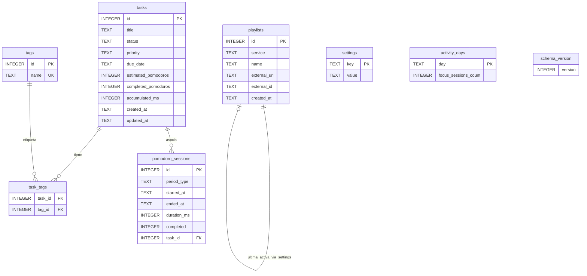

# Diseño de base de datos — Aplicación Pomodoro

**Motor:** SQLite 3  
**Ubicación:** `{app.getPath('userData')}/pomodoro.db`  
**Acceso:** solo desde el proceso Main (repositorio); el Renderer no abre la BD.  
**Referencias:** [01 requerimientos.md](01%20requerimientos.md), [02 historias-usuario.md](02%20historias-usuario.md), [03 diseño-arquitectura.md](03%20diseño-arquitectura.md).

## 1. Principios

- Un usuario por instalación; sin tabla de cuentas en el MVP.
- Claves enteras `INTEGER PRIMARY KEY` (rowid).
- Fechas/horas en **ISO-8601 UTC** (`TEXT`) o epoch ms (`INTEGER`); la UI convierte a zona local del SO.
- Enumeraciones como `TEXT` con valores controlados en la capa de servicio.
- Soft-delete no requerido en MVP (borrado físico), salvo decisión futura.
- Al eliminar una tarea: `pomodoro_sessions.task_id` pasa a `NULL` (ON DELETE SET NULL) para conservar historial de enfoque.

## 2. Diagrama entidad-relación



## 3. Tablas

### 3.1 `schema_version`

Control de migraciones.

| Columna | Tipo | Restricciones | Descripción |
|---------|------|---------------|-------------|
| version | INTEGER | NOT NULL | Versión actual del esquema (MVP = 1) |

Se puede usar una sola fila, o la convención `PRAGMA user_version` además de esta tabla. **Decisión MVP:** `PRAGMA user_version` como fuente de verdad; tabla opcional de log de migraciones no obligatoria.

### 3.2 `tasks`

| Columna | Tipo | Restricciones | Descripción |
|---------|------|---------------|-------------|
| id | INTEGER | PK, AUTOINCREMENT | Identificador |
| title | TEXT | NOT NULL | Título |
| status | TEXT | NOT NULL | `blocked` \| `todo` \| `in_progress` \| `done` \| `cancelled` |
| priority | TEXT | NOT NULL DEFAULT `'medium'` | `high` \| `medium` \| `low` |
| due_date | TEXT | NULL | Fecha límite `YYYY-MM-DD` (local interpretada) |
| estimated_pomodoros | INTEGER | NOT NULL DEFAULT 0 | Estimación |
| completed_pomodoros | INTEGER | NOT NULL DEFAULT 0 | Completados |
| accumulated_ms | INTEGER | NOT NULL DEFAULT 0 | Tiempo de concentración acumulado |
| created_at | TEXT | NOT NULL | ISO-8601 |
| updated_at | TEXT | NOT NULL | ISO-8601 |

**Mapeo UI (ES) ↔ valores**

| UI | Valor BD |
|----|----------|
| Bloqueado | `blocked` |
| Por hacer | `todo` |
| En curso | `in_progress` |
| Hecha | `done` |
| Cancelada | `cancelled` |
| Alta / Media / Baja | `high` / `medium` / `low` |

### 3.3 `tags`

| Columna | Tipo | Restricciones | Descripción |
|---------|------|---------------|-------------|
| id | INTEGER | PK, AUTOINCREMENT | |
| name | TEXT | NOT NULL, UNIQUE COLLATE NOCASE | Nombre etiqueta (p. ej. `english`) |

### 3.4 `task_tags`

| Columna | Tipo | Restricciones | Descripción |
|---------|------|---------------|-------------|
| task_id | INTEGER | PK, FK → tasks(id) ON DELETE CASCADE | |
| tag_id | INTEGER | PK, FK → tags(id) ON DELETE CASCADE | |

Clave primaria compuesta `(task_id, tag_id)`.

### 3.5 `pomodoro_sessions`

| Columna | Tipo | Restricciones | Descripción |
|---------|------|---------------|-------------|
| id | INTEGER | PK, AUTOINCREMENT | |
| period_type | TEXT | NOT NULL | `focus` \| `short_break` \| `long_break` |
| started_at | TEXT | NOT NULL | Inicio |
| ended_at | TEXT | NULL | Fin (NULL si se cancela a mitad; en MVP las canceladas pueden no insertarse) |
| duration_ms | INTEGER | NOT NULL | Duración efectiva del periodo planificado o completado |
| completed | INTEGER | NOT NULL DEFAULT 0 | 0/1 |
| task_id | INTEGER | NULL, FK → tasks(id) ON DELETE SET NULL | Solo relevante en `focus` |

**Regla de escritura (MVP):** insertar fila solo cuando `completed = 1` (periodo llegado a 00:00). Así se simplifica historial y estadísticas.

### 3.6 `playlists`

| Columna | Tipo | Restricciones | Descripción |
|---------|------|---------------|-------------|
| id | INTEGER | PK, AUTOINCREMENT | |
| service | TEXT | NOT NULL | `spotify` (MVP); futuro `youtube_music` |
| name | TEXT | NOT NULL | Nombre visible |
| external_url | TEXT | NOT NULL | URL o URI |
| external_id | TEXT | NULL | ID parseado si aplica |
| created_at | TEXT | NOT NULL | |

La playlist activa y la “última usada” se guardan en `settings` (`active_playlist_id`, `last_playlist_id`) para no duplicar estado.

### 3.7 `settings`

Almacén clave/valor.

| Columna | Tipo | Restricciones | Descripción |
|---------|------|---------------|-------------|
| key | TEXT | PK | Clave |
| value | TEXT | NOT NULL | Valor serializado (string/JSON número booleano) |

**Claves MVP sugeridas**

| key | Ejemplo de value | Significado |
|-----|------------------|-------------|
| focus_minutes | `25` | Duración concentración |
| short_break_minutes | `5` | Descanso corto |
| long_break_minutes | `15` | Descanso largo |
| pomodoros_until_long_break | `4` | Ciclo N |
| sound_enabled | `true` | Sonido |
| notifications_enabled | `true` | Notificaciones |
| locale | `es` | Idioma |
| mcp_enabled | `false` | Servidor / tools MCP activos |
| active_playlist_id | `3` | Lista activa |
| last_playlist_id | `3` | Última usada |
| active_task_id | `12` | Tarea activa actual (opcional) |

### 3.8 `activity_days`

Soporte eficiente de racha diaria (HU-19). Alternativa: derivar solo desde `pomodoro_sessions`; esta tabla es un **caché/agregado** actualizado al completar un `focus`.

| Columna | Tipo | Restricciones | Descripción |
|---------|------|---------------|-------------|
| day | TEXT | PK | Día local `YYYY-MM-DD` |
| focus_sessions_count | INTEGER | NOT NULL DEFAULT 0 | Pomodoros focus completados ese día |

Si se omite la tabla, `StreakService` consulta `DATE(started_at, 'localtime')` sobre sesiones; para MVP ambas son válidas. **Decisión:** incluir `activity_days` para lecturas O(1) de racha.

## 4. Índices

```sql
CREATE INDEX idx_tasks_status ON tasks(status);
CREATE INDEX idx_tasks_priority ON tasks(priority);
CREATE INDEX idx_tasks_due_date ON tasks(due_date);
CREATE INDEX idx_tasks_created_at ON tasks(created_at);
CREATE INDEX idx_sessions_started_at ON pomodoro_sessions(started_at);
CREATE INDEX idx_sessions_task_id ON pomodoro_sessions(task_id);
CREATE INDEX idx_sessions_type_completed ON pomodoro_sessions(period_type, completed);
CREATE INDEX idx_task_tags_tag_id ON task_tags(tag_id);
```

## 5. DDL inicial (referencia)

```sql
PRAGMA foreign_keys = ON;
PRAGMA user_version = 1;

CREATE TABLE tasks (
  id INTEGER PRIMARY KEY AUTOINCREMENT,
  title TEXT NOT NULL,
  status TEXT NOT NULL CHECK (status IN ('blocked','todo','in_progress','done','cancelled')),
  priority TEXT NOT NULL DEFAULT 'medium'
    CHECK (priority IN ('high','medium','low')),
  due_date TEXT,
  estimated_pomodoros INTEGER NOT NULL DEFAULT 0,
  completed_pomodoros INTEGER NOT NULL DEFAULT 0,
  accumulated_ms INTEGER NOT NULL DEFAULT 0,
  created_at TEXT NOT NULL,
  updated_at TEXT NOT NULL
);

CREATE TABLE tags (
  id INTEGER PRIMARY KEY AUTOINCREMENT,
  name TEXT NOT NULL COLLATE NOCASE UNIQUE
);

CREATE TABLE task_tags (
  task_id INTEGER NOT NULL REFERENCES tasks(id) ON DELETE CASCADE,
  tag_id INTEGER NOT NULL REFERENCES tags(id) ON DELETE CASCADE,
  PRIMARY KEY (task_id, tag_id)
);

CREATE TABLE pomodoro_sessions (
  id INTEGER PRIMARY KEY AUTOINCREMENT,
  period_type TEXT NOT NULL
    CHECK (period_type IN ('focus','short_break','long_break')),
  started_at TEXT NOT NULL,
  ended_at TEXT,
  duration_ms INTEGER NOT NULL,
  completed INTEGER NOT NULL DEFAULT 0 CHECK (completed IN (0, 1)),
  task_id INTEGER REFERENCES tasks(id) ON DELETE SET NULL
);

CREATE TABLE playlists (
  id INTEGER PRIMARY KEY AUTOINCREMENT,
  service TEXT NOT NULL,
  name TEXT NOT NULL,
  external_url TEXT NOT NULL,
  external_id TEXT,
  created_at TEXT NOT NULL
);

CREATE TABLE settings (
  key TEXT PRIMARY KEY,
  value TEXT NOT NULL
);

CREATE TABLE activity_days (
  day TEXT PRIMARY KEY,
  focus_sessions_count INTEGER NOT NULL DEFAULT 0
);
```

(Más los `CREATE INDEX` de la sección 4.)

## 6. Consultas típicas

**Tareas vencidas (hoy local `YYYY-MM-DD` = `:today`):**

```sql
SELECT * FROM tasks
WHERE due_date IS NOT NULL
  AND due_date < :today
  AND status NOT IN ('done', 'cancelled');
```

**Pomodoros focus en un rango:**

```sql
SELECT COUNT(*), COALESCE(SUM(duration_ms), 0)
FROM pomodoro_sessions
WHERE period_type = 'focus'
  AND completed = 1
  AND started_at >= :from_iso
  AND started_at < :to_iso;
```

**Exportación con filtro de estado:**

```sql
SELECT t.*, GROUP_CONCAT(g.name, ',') AS tags
FROM tasks t
LEFT JOIN task_tags tt ON tt.task_id = t.id
LEFT JOIN tags g ON g.id = tt.tag_id
WHERE (:status IS NULL OR t.status = :status)
GROUP BY t.id;
```

**Racha:** leer días en `activity_days` ordenados desc desde hoy/ayer y contar consecutivos (lógica en `StreakService`).

## 7. Integridad y transacciones

Al completar un pomodoro `focus` con tarea:

1. `BEGIN`
2. `INSERT` en `pomodoro_sessions`
3. `UPDATE tasks SET completed_pomodoros = completed_pomodoros + 1, accumulated_ms = accumulated_ms + :ms, updated_at = :now`
4. Upsert `activity_days` (+1)
5. `COMMIT`

Si falla cualquier paso → `ROLLBACK`.

## 8. Migraciones

| Versión | Cambio |
|---------|--------|
| 1 | Esquema MVP de este documento |

Procedimiento: al arrancar Main, leer `PRAGMA user_version`; aplicar scripts incrementales en orden; actualizar `user_version`.

## 9. Volumetría estimada (MVP)

| Entidad | Orden de magnitud |
|---------|-------------------|
| tasks | cientos–miles |
| sessions | miles–decenas de miles / año |
| tags | decenas |
| playlists | decenas |

SQLite es adecuado sin partición.

## 10. Privacidad

Todos los datos permanecen en el dispositivo del usuario. No hay telemetría de BD en el diseño MVP. El usuario es responsable de los archivos que exporte (CSV/JSON).

El acceso MCP opera sobre la misma base local: solo debe habilitarse conscientemente (`mcp_enabled`). El transporte MVP es stdio (proceso local); no se exponen datos a Internet por el diseño del servidor MCP.
