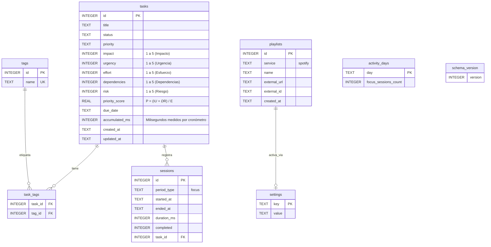

# Diseño de base de datos — Aplicación Focus (Cronómetro y Priorización Vectorial)

**Motor:** SQLite 3  
**Ubicación:** `{app.getPath('userData')}/pomodoro.db`  
**Acceso:** Exclusivo desde el proceso Main a través de `sqlite3`; el Renderer nunca interactúa directamente con la base de datos.  
**Referencias:** [01 requerimientos.md](01%20requerimientos.md), [02 historias-usuario.md](02%20historias-usuario.md), [03 diseño-arquitectura.md](03%20diseño-arquitectura.md).

---

## 1. Principios de persistencia

- **Almacenamiento completamente local:** No requiere cuentas en la nube ni telemetría externa.
- **Identificadores enteros:** Claves primarias numéricas `INTEGER PRIMARY KEY AUTOINCREMENT`.
- **Fechas y horas:** Cadenas de texto en formato **ISO-8601 UTC** (`YYYY-MM-DDTHH:mm:ss.sssZ`).
- **Control de versiones de esquema:** Gestionado mediante la tabla `schema_version` y comprobación con `PRAGMA user_version`.
- **Integridad referencial:** Activada mediante `PRAGMA foreign_keys = ON;`.
- **Eliminación en cascada:** Al borrar una tarea, sus vínculos en `task_tags` se eliminan en cascada (`ON DELETE CASCADE`), mientras que las sesiones históricas mantienen la integridad desvinculando la tarea (`ON DELETE SET NULL`).

---

## 2. Diagrama entidad-relación



---

## 3. Definición de tablas

### 3.1 `tasks` (Tareas con Vector de Priorización)

Almacena las unidades de trabajo y los valores del vector $\vec{t} = [I, U, E, D, R]$, junto con el resultado de la fórmula de prioridad $P$.

| Columna | Tipo | Restricciones | Descripción |
|---------|------|---------------|-------------|
| `id` | INTEGER | PK, AUTOINCREMENT | Identificador único de la tarea. |
| `title` | TEXT | NOT NULL | Título descriptivo de la tarea. |
| `status` | TEXT | NOT NULL DEFAULT `'todo'` | Estado: `blocked`, `todo`, `in_progress`, `done`, `cancelled`. |
| `priority` | TEXT | NOT NULL DEFAULT `'medium'` | Nivel cualitativo derivado: `high`, `medium`, `low`. |
| `impact` | INTEGER | NOT NULL DEFAULT 3 | $I$ (Impacto): Valor que aporta completar la tarea (1-5). |
| `urgency` | INTEGER | NOT NULL DEFAULT 3 | $U$ (Urgencia): Cercanía de la fecha límite (1-5). |
| `effort` | INTEGER | NOT NULL DEFAULT 2 | $E$ (Esfuerzo): Recursos/tiempo/energía requeridos (1-5, $\ge 1$). |
| `dependencies` | INTEGER | NOT NULL DEFAULT 1 | $D$ (Dependencias): Otras tareas bloqueadas por esta (1-5). |
| `risk` | INTEGER | NOT NULL DEFAULT 2 | $R$ (Riesgo): Consecuencias de no realizarla ahora (1-5). |
| `priority_score` | REAL | NOT NULL DEFAULT 0.0 | Puntaje calculado: $P = \frac{(I \times U) + (D \times R)}{E}$. |
| `due_date` | TEXT | NULL | Fecha límite en formato `YYYY-MM-DD`. |
| `accumulated_ms` | INTEGER | NOT NULL DEFAULT 0 | Tiempo total dedicado medido por el cronómetro (en ms). |
| `created_at` | TEXT | NOT NULL | Marca temporal ISO-8601 de creación. |
| `updated_at` | TEXT | NOT NULL | Marca temporal ISO-8601 de última actualización. |

### 3.2 `tags` (Etiquetas)

| Columna | Tipo | Restricciones | Descripción |
|---------|------|---------------|-------------|
| `id` | INTEGER | PK, AUTOINCREMENT | Identificador de la etiqueta. |
| `name` | TEXT | NOT NULL, UNIQUE COLLATE NOCASE | Nombre de la etiqueta (ej: `frontend`, `urgente`). |

### 3.3 `task_tags` (Relación Tareas-Etiquetas)

| Columna | Tipo | Restricciones | Descripción |
|---------|------|---------------|-------------|
| `task_id` | INTEGER | PK, FK → `tasks(id)` ON DELETE CASCADE | ID de la tarea. |
| `tag_id` | INTEGER | PK, FK → `tags(id)` ON DELETE CASCADE | ID de la etiqueta. |

### 3.4 `sessions` (Historial de Enfoque con Cronómetro)

| Columna | Tipo | Restricciones | Descripción |
|---------|------|---------------|-------------|
| `id` | INTEGER | PK, AUTOINCREMENT | Identificador de la sesión. |
| `period_type` | TEXT | NOT NULL DEFAULT `'focus'` | Tipo de sesión de concentración. |
| `started_at` | TEXT | NOT NULL | Inicio de la sesión (ISO-8601). |
| `ended_at` | TEXT | NULL | Fin de la sesión (ISO-8601). |
| `duration_ms` | INTEGER | NOT NULL | Duración total cronometrada en milisegundos. |
| `completed` | INTEGER | NOT NULL DEFAULT 1 | Indicador de finalización (1 = registrada). |
| `task_id` | INTEGER | NULL, FK → `tasks(id)` ON DELETE SET NULL | Tarea a la que se acreditó la sesión. |

### 3.5 `playlists` (Música y Enfoque)

| Columna | Tipo | Restricciones | Descripción |
|---------|------|---------------|-------------|
| `id` | INTEGER | PK, AUTOINCREMENT | Identificador único. |
| `service` | TEXT | NOT NULL DEFAULT `'spotify'` | Proveedor de música. |
| `name` | TEXT | NOT NULL | Título visible de la lista. |
| `external_url` | TEXT | NOT NULL | Enlace de reproducción (Spotify URL/URI). |
| `external_id` | TEXT | NULL | ID interno parseado si aplica. |
| `created_at` | TEXT | NOT NULL | Fecha de adición. |

### 3.6 `settings` (Configuración de la Aplicación)

Almacén clave-valor para preferencias del sistema.

| Columna | Tipo | Restricciones | Descripción |
|---------|------|---------------|-------------|
| `key` | TEXT | PRIMARY KEY | Identificador de configuración. |
| `value` | TEXT | NOT NULL | Valor serializado (JSON, booleano o string). |

**Valores predeterminados:**

| Clave | Valor por defecto | Descripción |
| ----- | ----------------- | ----------- |
| `sound_enabled` | `'true'` | Emisión de avisos sonoros. |
| `notifications_enabled` | `'true'` | Notificaciones nativas del SO. |
| `locale` | `'es'` | Idioma de la interfaz de usuario. |
| `mcp_enabled` | `'false'` | Servidor MCP para asistentes de IA activado. |
| `active_playlist_id` | `null` | Lista de Spotify activa. |
| `active_task_id` | `null` | Tarea en curso vinculada al cronómetro. |

*(Nota: Se eliminaron las claves obsoletas de intervalos de descanso pomodoro `focus_minutes`, `short_break_minutes`, etc.)*

### 3.7 `activity_days` (Racha de Enfoque)

| Columna | Tipo | Restricciones | Descripción |
|---------|------|---------------|-------------|
| `day` | TEXT | PRIMARY KEY | Fecha local en formato `YYYY-MM-DD`. |
| `focus_sessions_count` | INTEGER | NOT NULL DEFAULT 0 | Número de sesiones de cronómetro completadas en el día. |

---

## 4. Índices para optimización de consultas

```sql
-- Índices para ordenación rápida por Prioridad Vectorial y filtrado
CREATE INDEX IF NOT EXISTS idx_tasks_priority_score ON tasks(priority_score DESC);
CREATE INDEX IF NOT EXISTS idx_tasks_status ON tasks(status);
CREATE INDEX IF NOT EXISTS idx_tasks_due_date ON tasks(due_date);
CREATE INDEX IF NOT EXISTS idx_tasks_created_at ON tasks(created_at);

-- Índices para relaciones e historial
CREATE INDEX IF NOT EXISTS idx_task_tags_tag_id ON task_tags(tag_id);
CREATE INDEX IF NOT EXISTS idx_sessions_started_at ON sessions(started_at);
CREATE INDEX IF NOT EXISTS idx_sessions_task_id ON sessions(task_id);
```

---

## 5. Historial de migraciones

Las migraciones se ejecutan secuencialmente al arrancar el proceso principal de Electron (`electron-main/db/migrations.js`):

### Migración Versión 1 (Esquema Inicial)
- Creación de tablas base `tasks`, `tags`, `task_tags`, `sessions`, `playlists`, `settings`, `activity_days`.
- Creación de índices iniciales.

### Migración Versión 2 (Cronómetro de Enfoque y Priorización Vectorial)
- **Modificación de tabla `tasks`:**
  - Inclusión de columnas vectoriales: `impact`, `urgency`, `effort`, `dependencies`, `risk`.
  - Inclusión de la columna calculada `priority_score` (REAL).
  - Cálculo retroactivo de `priority_score` para todas las tareas existentes aplicando la fórmula:
    $$P = \frac{(I \times U) + (D \times R)}{E}$$
  - Creación del índice `idx_tasks_priority_score` sobre `priority_score DESC`.
- **Limpieza de tabla `settings`:**
  - Depuración de claves obsoletas de intervalos Pomodoro (`focus_minutes`, `short_break_minutes`, `long_break_minutes`, `pomodoros_until_long_break`).
- **Actualización de versión:**
  - `UPDATE schema_version SET version = 2;` y `PRAGMA user_version = 2;`.

---

## 6. Consultas frecuentes

### 6.1 Listar tareas activas ordenadas por Prioridad Vectorial

```sql
SELECT 
  t.*,
  GROUP_CONCAT(g.name, ',') AS tags
FROM tasks t
LEFT JOIN task_tags tt ON tt.task_id = t.id
LEFT JOIN tags g ON g.id = tt.tag_id
WHERE t.status IN ('in_progress', 'todo', 'blocked')
GROUP BY t.id
ORDER BY 
  CASE t.status 
    WHEN 'in_progress' THEN 0 
    WHEN 'todo' THEN 1 
    WHEN 'blocked' THEN 2 
    ELSE 3 
  END ASC,
  t.priority_score DESC,
  t.created_at DESC;
```

### 6.2 Acreditar tiempo continuo de cronómetro a una tarea

```sql
UPDATE tasks
SET 
  accumulated_ms = accumulated_ms + :delta_ms,
  updated_at = :now_iso
WHERE id = :task_id;
```
